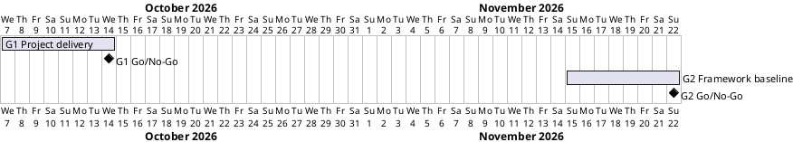

# Project Plan

## Metadata
| Key | Value |
| --- | --- |
| ID | PP-001 |
| CrossReference | [BC-001], [SA-001], [MIL-001], [MIL-002] |
| Language | en |
| Domain | education |

## Version History
| Date | Status | Author | Reviewer | Change | Commit |
| --- | --- | --- | --- | --- | --- |
| 2026-10-07 | Deprecated | Jens Tirsvad Nielsen | S01 | Initial version | [c55db0e] |
| 2026-11-15 | Accepted | Jens Tirsvad Nielsen | AI as stand-in for S01 | Added the baseline gateway G2 (MIL-002), its scope coverage, dependency, risk and Gantt entries; sources on the assumptions; marked G1 as not synced to the git host; set the domain to education; reviewed in autonomous mode, not independent | pending |

---

## Purpose

Schedules the delivery phase of the Pretty Table assignment so that the repository can be published within one week, as the Business Case's small-scope constraint implies. A second gateway, [MIL-002], was added on 2026-11-15 to bring the finished project to the baseline of the framework.

## Planning Assumptions

- Week 1 starts 2026-10-07; the plan ends by 2026-10-14 (source: [BC-001], Constraints).
- The baseline gateway G2 [MIL-002] starts 2026-11-15 and ends by 2026-11-22, one week (source: [BC-001], Constraints). The end date of the plan moves from 2026-10-14 to 2026-11-22 because of it; the reason is the agreed minimum quality baseline of the framework.
- One delivery phase of one week, then the baseline phase of one week; the Product Owner (S01) is the only decision maker, per [SA-001]. For the baseline gateway the review is done by an AI stand-in for S01 (source: [SA-001], Conflicting Interests).

## Gateway Schedule

| Gateway | Document | Window | Decision date | Owner | Stories | Main deliverable | Milestone |
| --- | --- | --- | --- | --- | --- | --- | --- |
| G1 Project delivery | [MIL-001] | 2026-10-07 to 2026-10-14 | 2026-10-14 | S01 | none | Tested, documented Python project and published repository metadata | not synced |
| G2 Framework baseline | [MIL-002] | 2026-11-15 to 2026-11-22 | 2026-11-22 | S01 | none (documentation and technical tasks) | The framework release, the wiki in three languages, the README, the licence metadata, the traceability matrix and the review records | [Milestone 518] |



## Scope Coverage

| Business Case scope item | Gateway |
| --- | --- |
| Source under `src/`, tests under `tests/`, documents under `docs/` | G1 |
| `pyproject.toml`, `.gitignore`, `Doxyfile`, README | G1 |
| Repository description and topics | G1 |
| The baseline phase: framework release, wiki, README template, licence metadata, traceability matrix, review records | G2 |

## Dependencies

```
G1 Project delivery -> G2 Framework baseline
```

A No-Go on G1 moves the decision date until the failed criteria are fixed, and moves G2 and the end date of the plan by the same time. A No-Go on G2 moves the end date; S01 decides the new date.

## Plan Risks

| Risk | Impact | Mitigation |
| --- | --- | --- |
| Git host API is unavailable for description and topics | Task cannot be completed | Set them by hand on the repository page |
| A continuous integration (CI) check fails on the pull request of [MIL-002] | The merge is delayed past 2026-11-22 | The failure is fixed on the same branch and the checks run again; after three failed rounds on one cause the work stops and S01 decides (trace: [BC-001], Risks) |

## Open Issues

- The assignment's exact function names are not given in the task text; the code uses `create_table` and `main`, to be adjusted if S01 names others.
- The existing source and tests are not reviewed again in the baseline phase; [RC-004] stays the review of the source code.
- The published wiki is checked on the git host after the merge, because the host copies it only then.

---

[BC-001]: ./business-case.md
[SA-001]: ./stakeholder-analysis.md
[MIL-001]: ./milestones/mil-001-pretty-table-project.md
[c55db0e]: https://git.tirsystem.com/Tirsvad-Udemy-100_days_of_code/016-pretty_table/commit/c55db0e0f2f7c259018b85a90824b124cc0b780d
[MIL-002]: ./milestones/mil-002-framework-baseline.md
[RC-004]: ./sqa/reviews/rc-004-python-source-code.md
[Milestone 518]: https://git.tirsystem.com/Tirsvad-Udemy-100-days-of-code/016-pretty-table/milestone/518
